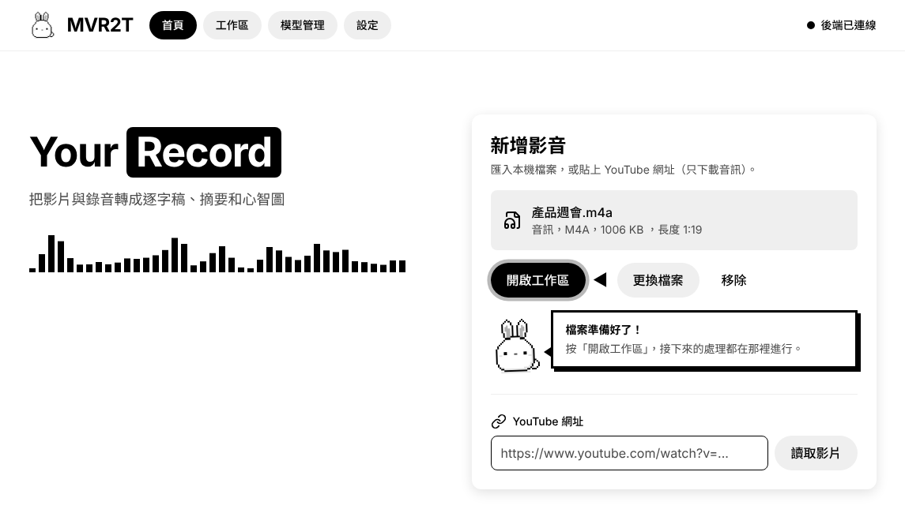
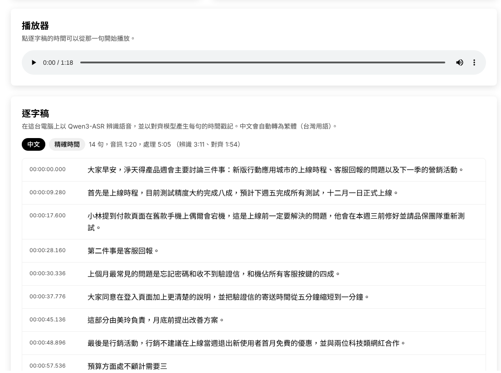
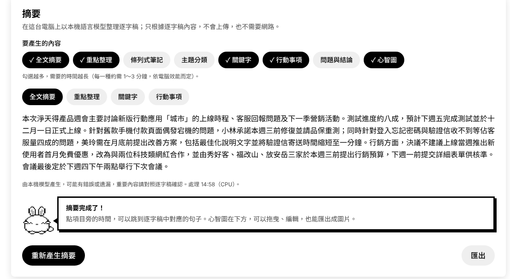
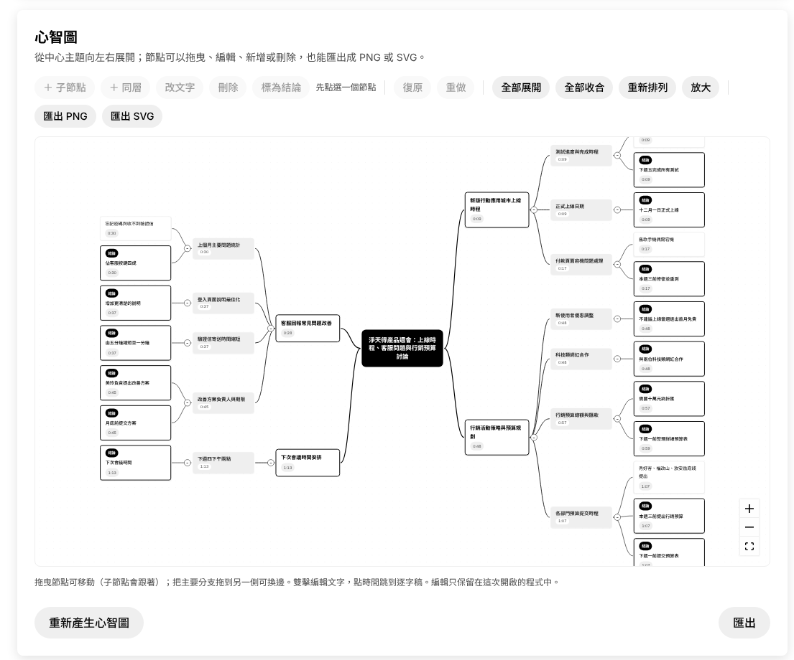
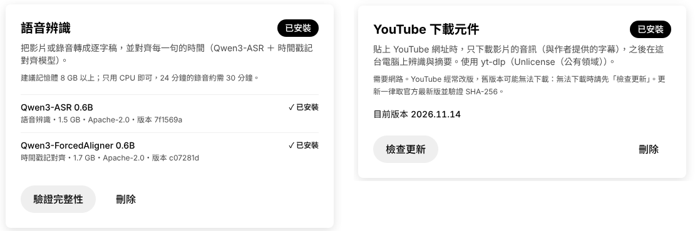
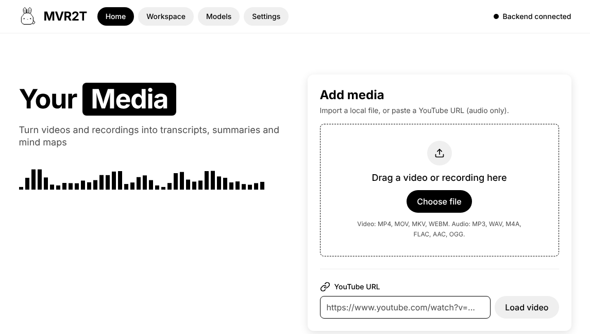

# MVR2T – Local Media Studio

**把影片與錄音轉成逐字稿、摘要與心智圖，全部在你的電腦上完成。**

*Your Media. Your Video. Your Record.*

**[⬇ 下載 Windows 安裝檔](https://github.com/MocuAcqu/MVR2T/releases/latest)** ・ [English](#english)

 

  

## 為什麼是 MVR2T？

開會錄音、課堂錄影、訪談、Podcast……整理成文字通常要花上好幾個小時。MVR2T 用本機 AI 幫你完成：

- 🔒 **檔案不離開你的電腦**：語音辨識與摘要都在本機執行，不上傳到任何伺服器，也不需要帳號。
- ✈️ **離線也能用**：AI 模型只需下載一次，之後沒有網路也能辨識、摘要、匯出。
- 💸 **不需要付費 API**：不依賴雲端服務，也不按分鐘計費。
- 🧹 **不保存處理紀錄**：匯入的檔案只存在本次工作階段，關閉程式就清除。

## 功能

| 功能 | 說明 |
|---|---|
| 🎬 **匯入影音** | 拖曳 MP4、MOV、MKV、WEBM 影片或 MP3、WAV、M4A、FLAC、AAC、OGG 錄音；也可以貼上 YouTube 網址（只下載音訊） |
| 🗣️ **語音辨識** | Qwen3-ASR 辨識中文、英文、粵語、日文、韓文，並為每一句加上時間戳記；中文自動轉為繁體（台灣用語） |
| ✏️ **逐字稿編輯** | 修改文字、合併、刪除、復原；內建播放器，點時間就從那一句開始播放 |
| 📝 **AI 摘要** | 全文摘要、重點整理、條列筆記、主題分類、關鍵字、行動事項、問題與結論，重點可以跳回逐字稿原句 |
| 🧠 **心智圖** | 自動整理成心智圖，可以拖曳、編輯、展開收合，匯出 PNG／SVG |
| 📤 **匯出** | TXT、SRT、VTT、JSON、Markdown、CSV、Word、PDF，以及切段音檔 ZIP |
| 🌏 **雙語介面** | 繁體中文／English，隨時在設定中切換 |

## 畫面

**逐字稿：每一句都有時間戳記，點時間就能播放，也能直接編輯**

**摘要：一次產生多種整理方式，重點附上時間，點一下回到原句**

**心智圖：從中心主題向左右展開，可以拖曳與編輯**

<table>
  <tr>
    <td width="50%"><b>模型管理</b>：一鍵下載、驗證、更新 AI 模型 </td>
    <td width="50%"><b>English interface</b>：在設定中切換介面語言 </td>
  </tr>
</table>

截圖中的會議錄音是以文字轉語音產生的示範內容。

## 認識 Mono

Mono 是 MVR2T 的吉祥物，一隻像麻糬的像素兔子。抽取音訊時牠會戴上耳機跟著節奏搖擺，辨識時捧著小平板認真看，完成時舉手歡呼。
開啟「操作引導」後，Mono 會在每一步告訴你接下來要做什麼。

## 下載與安裝

1. 到 **[Releases](https://github.com/MocuAcqu/MVR2T/releases/latest)** 下載 `MVR2T-Setup-<版本>-x64.exe`。
2. 執行安裝檔。這個版本**沒有數位簽章**，Windows 會顯示「Windows 已保護您的電腦」：按「**其他資訊**」→「**仍要執行**」。
   防毒軟體（例如 Avast）可能會先掃描一次。安裝不需要系統管理員權限。
3. 開啟 MVR2T，到「**模型管理**」下載「語音辨識」與「摘要與心智圖」（約 6 GB，只需下載一次）。
4. 回到首頁，拖入一段影片或錄音就可以開始了。

**系統需求**

| 項目 | 需求 |
|---|---|
| 作業系統 | Windows 10／11（64 位元） |
| 記憶體 | 8 GB 以上（建議 16 GB） |
| 磁碟空間 | 約 10 GB（程式約 1.2 GB、AI 模型約 6 GB） |
| 網路 | 只有第一次下載模型與使用 YouTube 功能時需要 |
| 處理時間 | 只用 CPU 即可；以 i5 筆電為例，24 分鐘的錄音約需 30 分鐘辨識 |

> 解除安裝時會保留 `%APPDATA%\MVR2T`（已下載的模型與設定），重新安裝不必再下載；要完全移除請手動刪除該資料夾。

## 常見問題

<b>真的完全不會上傳嗎？</b>

語音辨識（Qwen3-ASR）與摘要（Qwen3.5-4B，透過 llama.cpp）都在你的電腦上執行。程式只有在你下載模型、
下載「YouTube 下載元件」或使用 YouTube 網址時才會連網。

<b>可以用 YouTube 影片嗎？</b>

可以，但請只用於你自己上傳、創用 CC 授權，或已取得權利人同意的影片。YouTube 的服務條款原則上不允許下載內容，
是否符合條款與著作權規定由使用者自行負責。程式只下載音訊，存放在本次工作階段的暫存，不支援登入、會員限定、私人影片、直播與播放清單。

<b>有 Mac 版嗎？</b>

目前沒有。專案中已準備 Apple Silicon 的打包設定，但還沒有在 Mac 上驗證，見[開發者說明](./docs/DEVELOPMENT.md)。

<b>有 NVIDIA 顯示卡會比較快嗎？</b>

有 NVIDIA 顯示卡時，可以在「模型管理」下載「摘要 GPU 加速」，摘要會改用 GPU。這個功能目前只有自動化測試，還沒有在實機上驗證。
語音辨識一律使用 CPU。

## English

**MVR2T – Local Media Studio** turns videos and recordings into transcripts, summaries and mind maps **entirely on your own PC**.
AI models are downloaded once and then run fully offline; nothing is uploaded and no account or paid API is needed.

- Speech recognition with sentence timestamps (Qwen3-ASR: Chinese, English, Cantonese, Japanese, Korean)
- Transcript editor with a built-in player, local AI summaries and an editable mind map
- Export to TXT, SRT, VTT, JSON, Markdown, CSV, Word, PDF, PNG and SVG
- **[Download the Windows installer](https://github.com/MocuAcqu/MVR2T/releases/latest)** (Windows 10/11 x64, 8 GB+ RAM, about 10 GB of disk).
  The installer is unsigned: on the SmartScreen prompt choose “More info” → “Run anyway”.
  Switch the interface in **Settings → Interface language**.

## 開發者

- [開發者說明](./docs/DEVELOPMENT.md)：環境設定、日常開發、打包 Windows 安裝程式、macOS（未驗證）
- [進度與驗收紀錄](./docs/PROGRESS.md)：各階段的驗收清單與已知限制
- [開發紀錄 DEV_LOG](./docs/DEV_LOG.md)・[產品規格 PROJECT_SPEC](./PROJECT_SPEC.md)・[設計規範](./docs/DESIGN_SYSTEM.md)

技術：Electron ＋ React ＋ TypeScript（介面）、Python ＋ FastAPI（本機後端）、PyTorch ＋ Transformers（語音辨識）、llama.cpp（摘要）、FFmpeg（影音處理）。

## 授權

MVR2T 的程式碼以 [MIT License](./LICENSE) 釋出。內附或下載的第三方軟體與模型（FFmpeg、Electron、PyTorch、Transformers、
llama.cpp、yt-dlp、Qwen 模型等）依各自的授權，見 [`THIRD_PARTY_NOTICES.md`](./apps/desktop/build-resources/THIRD_PARTY_NOTICES.md)。
